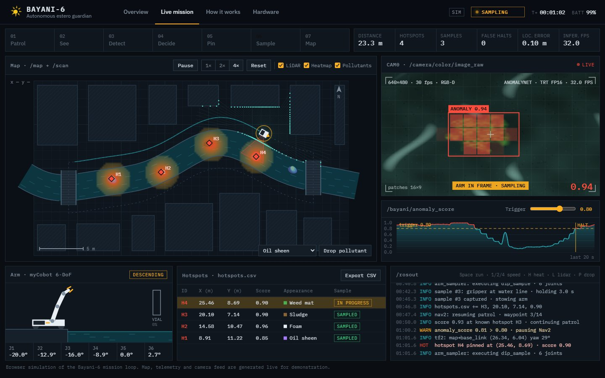

# BAYANI-6

**An autonomous robot that patrols urban creeks, spots pollution with on-board AI, pins each hotspot on a map and takes a water sample, with no human in the loop.**

*bayani* (ba·ya·ni) is Tagalog for **hero**.

**Live demo:** https://rithikhc.github.io/ESTERO-6/
**Auto-running mission (good for presenting):** https://rithikhc.github.io/ESTERO-6/?demo=2



---

## The problem

Illegal industrial dumping into the *esteros* (urban creeks) of Manila's Pasig River basin is linked to cholera, typhoid and heavy-metal exposure. Today's monitoring relies on fixed sensors that can't move, or manual sampling that is risky and takes weeks to come back from the lab.

## Why the Philippines

- **Feb 2023:** the tanker MT Princess Empress sank off Oriental Mindoro with 800,000 litres of industrial oil; more than 99,000 people in Oriental Mindoro were affected.
- **Jul 2024:** MT Terranova capsized in Manila Bay during Typhoon Carina carrying about 1.4 million litres of fuel oil.
- **Jul–Aug 2024:** after the floods, leptospirosis cases jumped from 251 to 1,184 in two weeks; Metro Manila had the most deaths.
- **1990 → 2008:** the Pasig was declared biologically dead around 1990; in 2008 the Supreme Court ordered agencies to clean up Manila Bay, work that now reaches the esteros.

Bayani-6 finds where pollution enters the esteros, gives a location and a sample on the spot, and keeps workers out of contaminated water.

## What Bayani-6 does

| Step | What happens |
|---|---|
| **01 Patrol** | Nav2 drives a waypoint route along the creek bank while Cartographer builds a live LiDAR map. |
| **02 See** | The Orbbec RGB-D camera streams the water surface into the Jetson. |
| **03 Detect** | An unsupervised, patch-based anomaly model trained only on **60 s of clean water** scores every frame from 0 to 1. |
| **04 Decide** | If the score passes the trigger (0.8) and the spot isn't already logged, the robot stops. |
| **05 Pin** | The exact (X, Y) position comes from the SLAM transform tree (`map → base_link`) via tf2. |
| **06 Sample** | The 6-DoF myCobot arm runs a dip sequence: reach, descend to the water line, hold 3 s, stow. |
| **07 Map** | The hotspot is appended to `hotspots.csv`, turned into a contamination heatmap, and the patrol resumes. |

**The camera faces forward. How does it see the water?** On the banks the LIMO drives in mecanum mode and crab-walks sideways, so the body and its camera face the water the whole time. With standard wheels the same job is done by an angled patrol (nose 30–45° toward the creek) or by stopping every few metres to turn and look.

**Where do samples go?** A 3D-printed rack on the rear deck holds six screw-cap tubes. Slot *n* holds the sample for hotspot H*n*, so every tube matches a row in `hotspots.csv`. The arm reaches 280 mm, so the demo arena keeps the water close to the bank edge; a pump line for high-walled esteros is on the roadmap.

**Why unsupervised?** Pollution doesn't come in neat labelled classes. Instead of training on thousands of labelled pictures of dirt, Bayani-6 learns what *normal* water looks like and flags anything that doesn't fit: oil sheens, sludge, foam, weed mats.

## Hardware

Unmodified **AgileX LIMO Cobot**:

- NVIDIA Jetson Orin Nano · Ubuntu 22.04 · ROS 2 Humble
- Orbbec RGB-D depth camera
- 2D LiDAR · Cartographer SLAM · Nav2
- myCobot 280 6-DoF arm

## Repository layout

```
docs/                     Interactive prototype dashboard (served by GitHub Pages)
  index.html              Overview · Live mission · How it works · Hardware
  js/world.js             Creek map, patrol route, LiDAR ray casting, heat grid
  js/camera.js            Simulated camera feed + AnomalyNet-style patch overlay
  js/arm.js               myCobot dip-sampling animation
  js/app.js               Mission state machine and UI
poster/                   Research-day posters (editable .pptx + .pdf)
ros2_ws/src/bayani_core/  ROS 2 package (reference implementation, see status below)
  anomaly_detector.py     Clean-water calibration + 0..1 anomaly score
  mission_master.py       Patrol -> halt -> tf2 pin -> sample -> CSV -> resume
  arm_sampler.py          myCobot dip sequence via pymycobot
  make_heatmap.py         hotspots.csv -> contamination heatmap PNG
```

## The dashboard

A browser simulation of the full mission loop, built to explain the project live, with Overview (including the Philippines story), Live mission, How it works and Hardware tabs. No install, no build step, no server code.

- **Map:** creek, buildings, patrol route, live LiDAR scan, camera footprint, logged hotspots and a growing contamination heatmap. Move the mouse over it for world coordinates.
- **Camera:** rendered water surface with real-looking pollutants and the patch-level anomaly heatmap the detector would produce.
- **Score chart:** live `/bayani/anomaly_score` with the trigger line and halt markers.
- **Crab-walk:** on the banks the robot drives sideways so its forward camera faces the water.
- **Arm and sample rack:** the myCobot dips a tube from the six-slot rack; each slot matches a hotspot.
- **Hotspot table and `/rosout`-style log:** follow each sample from trigger to CSV row.

**Presenting it**

1. Start on **Overview**, then hit **Launch live mission**.
2. Use **2×/4×** to speed things up and **Drop pollutant** to place a new slick anywhere in the creek. The robot will find it on its next pass.
3. Drag the **Trigger** slider down to about 0.6 to show why the threshold matters: surface glare starts causing false halts.
4. **Export CSV** downloads the logged hotspots.
5. Keyboard: `Space` run/pause · `1` `2` `4` speed · `H` heatmap · `L` LiDAR · `P` drop pollutant.

URL options: `?demo` opens the mission already running, and `?demo=4` also sets the speed.

**Run it locally:** open `docs/index.html` in a browser, or serve the folder:

```bash
cd docs && python -m http.server 8000
```

## ROS 2 package

> **Status:** reference implementation of the pipeline above. It has **not yet been validated on the robot**, so expect to tune poses, thresholds and topics during bring-up.

```bash
cd ros2_ws
colcon build --packages-select bayani_core
source install/setup.bash
pip install pymycobot            # arm control
# Start the LIMO driver, Orbbec camera, Cartographer and Nav2 first, then:
ros2 launch bayani_core bayani.launch.py calibration_video:=/path/to/clean_water_60s.mp4
```

- With no `calibration_video` and no saved baseline, the detector calibrates from the live camera for 60 s. Point it at clean water.
- Use `arm_dry_run:=true` to test the loop without moving the arm.
- Set your patrol route in `config/patrol_waypoints.yaml`.
- Make a heatmap: `ros2 run bayani_core make_heatmap --csv ~/.bayani/hotspots.csv --map my_map.yaml`.

Topics: `/bayani/anomaly_score` (Float32) · `/bayani/anomaly_heatmap` (Image) · `/bayani/hotspot` (PointStamped) · `/arm/command`, `/arm/status` (String).

## Posters

- [`poster/Bayani-6_Poster.pdf`](poster/Bayani-6_Poster.pdf): academic four-column layout ([editable .pptx](poster/Bayani-6_Poster.pptx))
- [`poster/Bayani-6_Landscape_Poster.pdf`](poster/Bayani-6_Landscape_Poster.pdf): A0 landscape layout ([editable .pptx](poster/Bayani-6_Landscape_Poster.pptx))

> Poster results come from the prototype software and the browser simulation. Field trials on the robot are the next step, so no accuracy figures are claimed yet.

## Roadmap

- Plain-English search with a vision-language model (e.g. NanoOWL): *"find frothy run-off"*
- pH, conductivity and turbidity probes on the gripper
- Several robots sharing one contamination map over Wi-Fi
- TensorRT export of the anomaly backbone

## Team

**Rithikh Chandran · Reuben Thomas**
Department of Electrical & Electronics Engineering, BITS Pilani, Dubai Campus

Product images of the LIMO Cobot used on the posters are © AgileX Robotics. BITS Pilani emblem © BITS Pilani.
